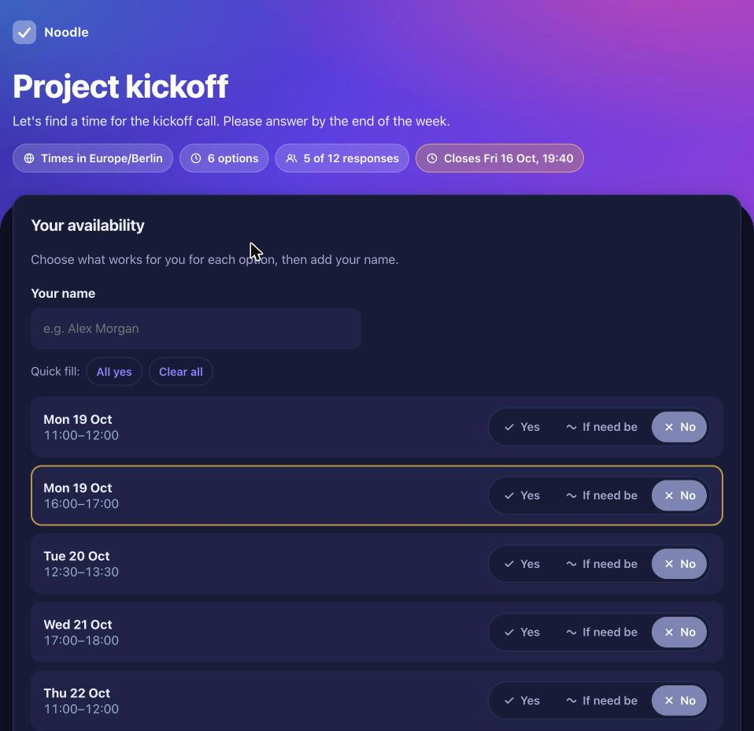
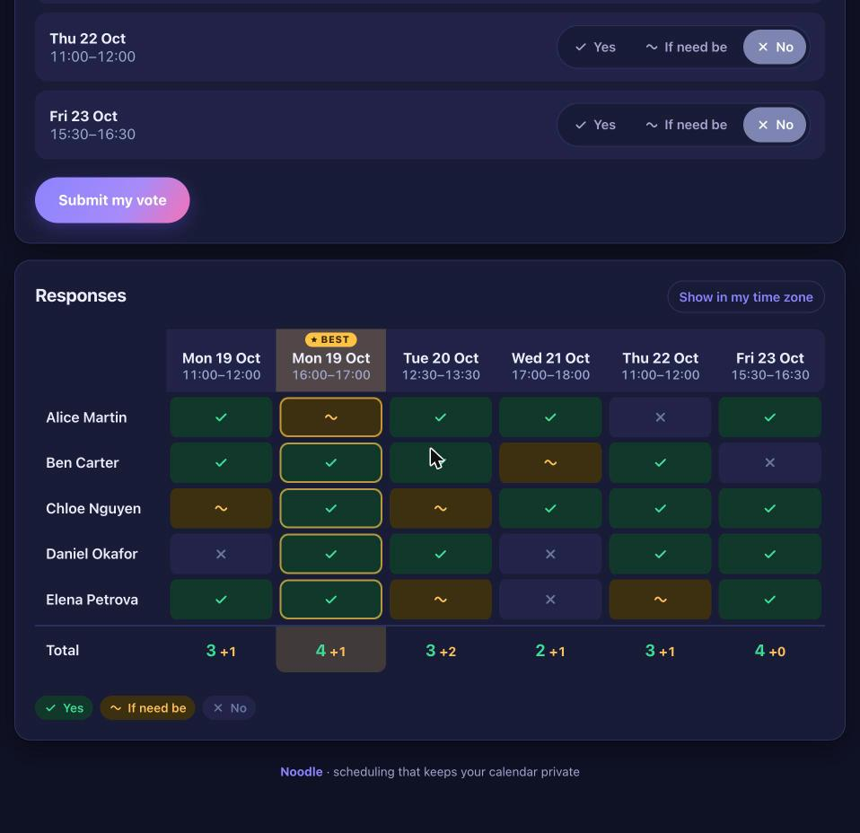

# Noodle

**A private, calendar-driven scheduling poll for ordinary PHP web hosting.**
Find a time that works for everyone, without handing your calendar to a third party and without running a database.

<p align="center">
  
  
</p>

Noodle has two parts that talk to each other over HTTPS:

| Part | Where it runs | What it does |
|---|---|---|
| **`noodle` command-line tool** (Swift) | Your Mac | Reads your calendars, finds your free time, publishes a poll, holds the slots in your calendar, shows results, books the winner and cleans up. |
| **Web part** (PHP, JSON files) | Any shared web host, FTP only | Serves the voting page and stores the votes. It never sees your calendar. |

```
 YOUR MAC                                           YOUR WEB HOST
┌────────────────────────────────┐   signed HTTPS  ┌─────────────────────────────────┐
│ noodle (Swift)                 │ ──────────────► │ api.php    management API       │
│  · reads Calendar (EventKit)   │                 │ index.php  voting page          │
│  · proposes free slots         │ ◄────────────── │ data/      one JSON file / poll │
│  · tentative holds + booking   │   poll link     └─────────────────────────────────┘
└────────────────────────────────┘                          ▲
        you send the link ───────────────────────────────►  │  people vote in any browser
```

## Why Noodle

- **You never click through a poll-creation form.** `noodle new --title "Project sync"` reads your calendars, proposes the free slots, lets you drop the ones you dislike, publishes, and puts the link on your clipboard.
- **Your calendar stays private.** Only the slots you approve are sent to the server. Event titles never leave your Mac.
- **It keeps your time safe while people vote.** Every proposed slot becomes a tentative hold in your calendar. When the poll is settled, the winner is confirmed and every other hold is deleted, automatically if you wish.
- **It runs anywhere PHP runs.** No database, no SQL, no SQLite, no Composer, no Node, no build step, no shell access on the server. Upload files by FTP and you are done.
- **There is no admin login page to attack.** All management is done from your Mac with signed requests.
- **It looks good.** Colourful, modern, responsive, light and dark mode (follows the system, with a button to switch), accessible (keyboard, screen readers, colour-blind-safe icons), and it works without JavaScript.
- **It contains no tracking.** No analytics, no cookies except a voter's own edit cookie, no external fonts, scripts or images, and no IP addresses are stored.

## Features

**For you (the organiser)**
- Free-slot finder with working hours, weekdays, slot length, step, buffer around events, minimum notice, per-day and total caps
- Choose which calendars count as busy; skips events marked *Free* and meetings you declined; tentative and all-day events are configurable
- Reserved-time rules, e.g. `"Fri 13:00-17:00"`, `"Mon-Fri 12:00-14:00"`, `"2026-12-24..2027-01-06"`
- Review and trim the proposed slots before anything is published
- Tentative hold events in a dedicated calendar, then booking of the winner into the calendar of your choice
- Deadline and maximum number of votes; optional "no *if need be*" polls and hidden individual votes
- Results in the terminal, CSV export, delete a vote, close, delete a poll
- Optional background agent: notification when a poll closes, automatic cleanup of unused holds

**For your invitees**
- One link, no account, no app
- Yes / *if need be* / no for every slot, a "best slot" highlight, totals, and all answers at a glance
- Come back later and change your own vote (tied to your browser, no password)
- Times shown in the poll's time zone, with a one-click switch to your own

## Quick start

You need a Mac (macOS 14 or newer with the Xcode Command Line Tools) and a web host with PHP 8.1+ and FTP access. The full guide is in [docs/installation.md](docs/installation.md).

```sh
# 1. Build the command-line tool
./build.sh

# 2. Create your secret key and the folder to upload (use your own address)
./build/noodle init --url https://example.com/noodle

# 3. Upload the CONTENTS of dist/noodle/ to the "noodle" folder of your website (FTP / file manager)

# 4. Check the installation end to end
./build/noodle doctor

# 5. Tell Noodle which calendars matter, then create your first poll
./build/noodle calendars
./build/noodle config          # then edit ~/.config/noodle/config.json
./build/noodle new --title "Project sync" --deadline "+3d"
```

The last command prints the link and copies it to your clipboard, ready to paste into an email.
When the votes are in:

```sh
./build/noodle results latest        # who voted what, best slot starred
./build/noodle book latest best      # confirm it in your calendar, delete the other holds
```

## Examples and shortcuts

Every option of `noodle new` overrides your settings for that one poll. A few typical polls:

```sh
# See what would be proposed, without creating anything
noodle new --title "Test" --dry-run

# A 30-minute call within the next two weeks, closing automatically in two days
noodle new --title "Quick call" --duration 30 --deadline "+2d"

# A specific date range, mornings only
noodle new --title "Planning" --from 2026-11-02 --to 2026-11-13 --hours 09:00-12:00

# Only Tuesdays and Thursdays, and keep Thursday afternoons free
noodle new --title "Office hours" --days Tue,Thu --reserve "Thu 14:00-18:00"

# Offer the lunch break this time (drop one reserved rule, or all of them, for this poll only)
noodle new --title "Lunch & learn" --unreserve "Mon-Fri 12:00-13:30"
noodle new --title "Anytime" --no-reserved

# A workshop with 8 seats: voting closes by itself after the 8th response; no calendar holds
noodle new --title "Workshop" --duration 120 --max-votes 8 --no-holds

# Ignore one of your calendars for this poll only
noodle new --title "Lunch" --hours 11:30-14:00 --calendars "Work"

# Voters see the totals but not who answered what, and there is no "if need be"
noodle new --title "Team feedback" --hide-votes --no-maybe
```

### Shell aliases and functions

Put the program on your `PATH` once, then add shortcuts to `~/.zshrc` (macOS uses zsh by default). Open a new Terminal window afterwards.

```sh
# Make "noodle" available everywhere (adjust the path to where you cloned the repository)
mkdir -p ~/.local/bin
ln -sf "$HOME/path/to/noodle/build/noodle" ~/.local/bin/noodle
# if ~/.local/bin is not on your PATH yet:
echo 'export PATH="$HOME/.local/bin:$PATH"' >> ~/.zshrc
```

```sh
# --- Noodle shortcuts (add to ~/.zshrc) ---

# meet "Project sync"      new poll, closes in 3 days, link copied to the clipboard
meet()  { noodle new --title "$*" --deadline "+3d"; }

# quick "Coffee chat"      short 30-minute poll, closes in 2 days
quick() { noodle new --title "$*" --duration 30 --deadline "+2d"; }

# seats 8 "Workshop"       a poll that closes after N responses and makes no calendar holds
seats() { local n="$1"; shift; noodle new --title "$*" --max-votes "$n" --no-holds; }

# preview                  show what a poll would propose, create nothing
alias preview='noodle new --title preview --dry-run'

# nr / nb / nx             results, book the best slot, release holds of the most recent poll
alias nr='noodle results latest'
alias nb='noodle book latest best'
alias nx='noodle release latest'

# np                       list all polls and their state
alias np='noodle polls'
```

Then a whole poll is two words:

```sh
meet "Project sync"     # paste the link into your email
nr                      # a few days later: who voted what
nb                      # confirm the best slot in your calendar
```

`latest` always means the poll you created most recently; use the poll id (or its first three characters, from `noodle polls`) for older ones. `book` and `release` ask before they change your calendar. Add `--yes` only in scripts where you really mean it.

To have your Mac tidy up on its own when polls close, install the background agent once with `noodle agent install` and choose what happens with `"onClose"` in the [configuration](docs/configuration.md#onclose).

## Documentation

| Document | Contents |
|---|---|
| [Installation](docs/installation.md) | Step-by-step setup, hosting requirements, FTP upload, first poll, updating, uninstalling |
| [Usage](docs/usage.md) | Every command and option, typical workflows |
| [Configuration](docs/configuration.md) | All settings, reserved-time rule syntax, server options |
| [Security](docs/security.md) | Threat model, every protection and its limits, hardening checklist |
| [Architecture](docs/architecture.md) | Components, data format, API protocol, request signing, calendar and agent lifecycle |
| [Troubleshooting](docs/troubleshooting.md) | Common problems and fixes |
| [Development](docs/development.md) | Project layout, running the tests, contributing |

## Security at a glance

- Management requests are signed with **HMAC-SHA256** using a 256-bit secret kept in your macOS Keychain; they expire after five minutes and every request works only once (no replay).
- Poll links contain a **128-bit random identifier**; file names are only ever derived from identifiers that match a strict pattern, so **path traversal** is impossible.
- Data files are guarded in two independent ways (`.htaccess` and a PHP guard line that makes a direct request return 404), and every write is **locked and atomic**, so simultaneous voters cannot corrupt a poll.
- Voting uses **signed single-poll form tokens**, a **honeypot**, **rate limiting** and **strict validation**; deadlines and vote limits are enforced **on the server under the lock**.
- Every value is **HTML-escaped**, with a **strict Content-Security-Policy** (no inline scripts or styles, no third-party requests), `no-referrer`, `nosniff` and `noindex`.
- The test suite attacks the system on purpose: injection, tampering, replay, traversal, bots and 30 simultaneous voters competing for 10 seats.

Read [docs/security.md](docs/security.md) for the details **and the limits**: for example, anyone with a poll link can vote, exactly as with other poll tools.

## Requirements

| | Minimum |
|---|---|
| **Your Mac** | macOS 14 (Sonoma) or newer, Xcode Command Line Tools (`xcode-select --install`), access to Calendar.app |
| **Web host** | PHP 8.1+ with the `json` and `mbstring` extensions, HTTPS, Apache with `.htaccess` support (or an equivalent nginx rule, see the installation guide), FTP/SFTP or a file manager |
| **Not needed** | Database, SSH, Composer, Node.js, cron on the server, email server |

## Project layout

```
client/      the `noodle` command-line tool (Swift, five source files, no dependencies)
server/
  public/    files that go into the web-visible folder: index.php, api.php, assets/, .htaccess
  app/       server code (Store, Poll, Votes, Auth, View); config.php is generated for you
tests/       automated server test suite (php tests/run.php)
docs/        documentation and screenshots
build.sh     builds and (if possible) code-signs the command-line tool
```

## Limitations

Noodle is deliberately small. It has no user accounts, no email sending, no password-protected polls, no per-voter authentication (names are self-declared), and the organiser tool is macOS-only. It targets a single organiser running a handful of polls, not a multi-tenant service. See [docs/security.md](docs/security.md#limitations-and-things-noodle-does-not-do) for the security-relevant ones.

## Contributing and security reports

See [CONTRIBUTING.md](CONTRIBUTING.md). Please report vulnerabilities privately as described in [SECURITY.md](SECURITY.md).

## License

[MIT](LICENSE)
